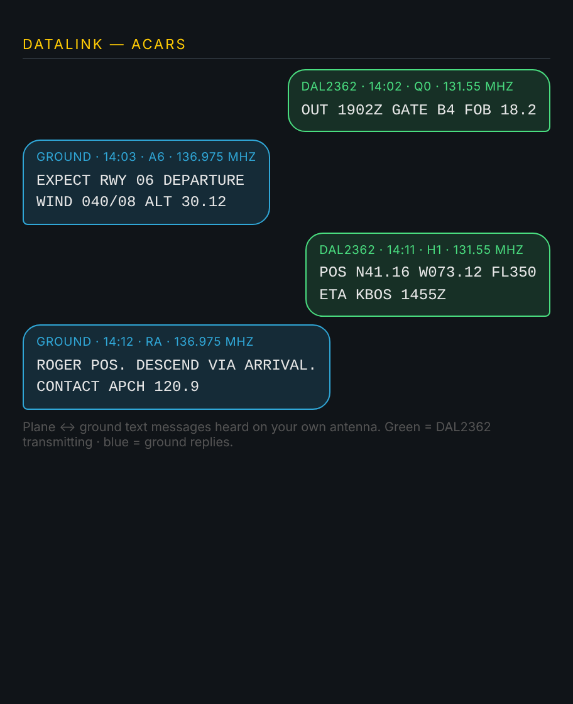
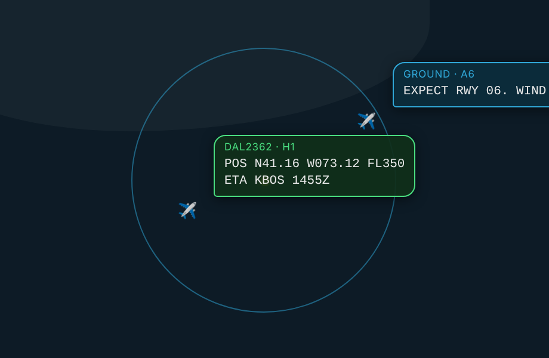

# ACARS Datalink — the planes' text messages

## What it is

ACARS (Aircraft Communications Addressing and Reporting System) is the text
messaging system of aviation. Aircraft and ground stations exchange short
messages constantly: position reports, out/off/on/in times, gate assignments,
weather requests, maintenance telemetry, and controller uplinks. It's all
unencrypted, on VHF, over your head right now.

OmniDex shows these as a **chat thread** on each plane's Dex detail page,
styled like a phone conversation:

- **Green bubbles, right side** — the plane transmitting (downlink).
- **Blue bubbles, left side** — ground / controller replies (uplink).

The section only appears on planes the receiver has actually heard, so an
empty radio stays invisible.

## What it looks like

The Dex detail page grows a chat thread, and fresh messages also pop up as
word bubbles next to the plane markers on the live map, fading out after a
few seconds (sample messages shown):

<p align="center">
  
</p>
<p align="center">
  
</p>

## Hardware & decoders

OmniDex does not demodulate ACARS itself — same philosophy as readsb for
ADS-B and AIS-catcher for ships. Run one (or both) of the standard decoders
on a spare RTL-SDR and point their JSON output at OmniDex's UDP port
(default `5555`):

```bash
# Classic VHF ACARS — several frequencies at once on one dongle:
sudo apt install -y acarsdec   # or build from github.com/TLeconte/acarsdec
acarsdec -o 0 -j 127.0.0.1:5555 -r <dongle-serial> 131.550 131.725 130.025 131.825

# VDL Mode 2 (the newer, busier digital channel on 136.975 MHz):
# build from github.com/szpajder/dumpvdl2
dumpvdl2 --rtlsdr <dongle-serial> \
         --output decoded:json:udp:address=127.0.0.1,port=5555 136975000
```

Both decoders can feed the same port simultaneously; OmniDex tells the
formats apart. Find dongle serials with `rtl_test`.

Tip: VDL-2 frames include the aircraft's ICAO hex address, which matches the
plane's Dex identity directly. Classic ACARS matches by registration or
flight number instead, which OmniDex resolves automatically.

## Settings

On the `/admin` page under **Air**:

| Setting | Default | Meaning |
|---|---|---|
| ACARS datalink | on | Listen for decoder JSON (restart to apply) |
| ACARS UDP port | 5555 | Where acarsdec / dumpvdl2 send JSON |

## API

- `GET /api/acars/plane/{hex}?reg=N123AB&flight=UAL123` — one airframe's
  messages, oldest first (chat order).
- `GET /api/acars/recent?n=30` — latest messages from any aircraft, plus
  receiver stats (`datagrams`, `messages`, `last_msg_ts`).

Messages live in a rolling in-memory buffer (default 600); nothing is
written to the database.

## House rules

Receive-only, like everything else here. ACARS is broadcast in the clear
and listening is legal in the US, but be a good citizen: the fun is watching
your own sky, not republishing other people's telemetry.
